# ProDugnad: all texts

Every text in the app, the emails and the link previews, as of 7 November 2026, with screenshots from the test data (tap a picture to see it full size). Numbered so changes can be referred to ("#23 → …"). Words in *italics* are filled in by the app; the examples use Ola Hansen, Emma, Kari Nordmann and Ready G2018.

## A. Friend order page (`/k/…`), the page most people see

<a href="screenshots/a-bestillingsside.jpg">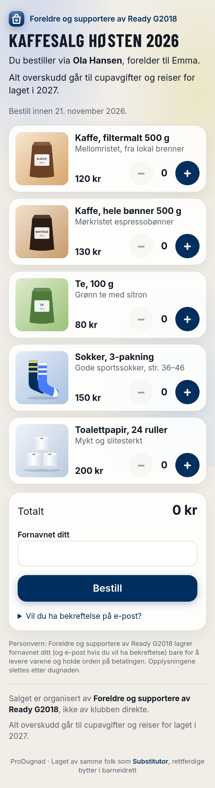</a> <a href="screenshots/a-din-bestilling-tidligere.jpg">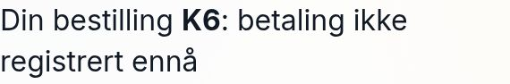</a>

Bestillingssiden · Tidligere bestilling på samme telefon (A19)

| # | Where | Text |
|---|---|---|
| A1 | Top, next to the logo | *Foreldre og supportere av Ready G2018* |
| A2 | Title | *Kaffesalg høsten 2026* |
| A3 | Under the title | Du bestiller via **Ola Hansen**, forelder til Emma. |
| A4 | Under that | *Alt overskudd går til cupavgifter og reiser for laget i 2027.* |
| A6 | Above the products | Bestill innen 20. november 2026. |
| A7 | Product card | *Kaffe, filtermalt 500 g* / *Mellomristet, fra lokal brenner* / *120 kr* |
| A8 | Total box | Totalt |
| A9 | Name field | Fornavnet ditt |
| A10 | Button | Bestill |
| A11 | Fold-out under the button | Vil du ha bekreftelse på e-post? |
| A12 | Inside it | E-post (valgfritt) |
| A13 | Privacy notice | Personvern: *Foreldre og supportere av Ready G2018* lagrer fornavnet ditt (og e-post hvis du vil ha bekreftelse) bare for å levere varene og holde orden på betalingen. Opplysningene slettes etter dugnaden. |
| A14 | Error, no name | Skriv inn fornavnet ditt. |
| A15 | Error, no products | Velg minst én vare. |
| A16 | Ordering closed (deadline) | Fristen for å bestille har gått ut. |
| A17 | Ordering closed (locked) | Bestillingen er stengt fordi varene er bestilt fra leverandøren. |
| A18 | Ordering closed (finished) | Dugnaden er avsluttet. |
| A19 | Earlier order on this phone | Din bestilling **K7**: betaling ikke registrert ennå / betalt / på vei / levert · Se → |
| A20 | Wrong link | Fant ikke denne lenken. Sjekk at du har hele lenken. |

## B. After ordering

<a href="screenshots/b-etter-bestilling.jpg">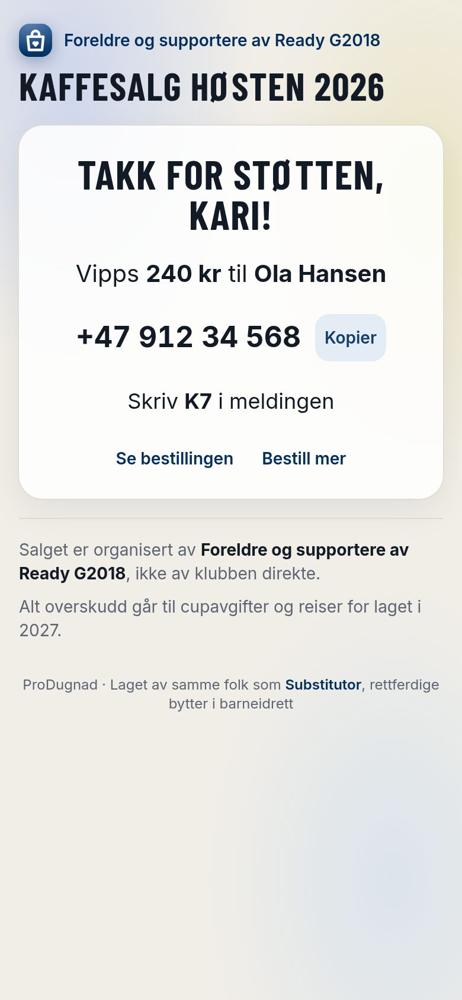</a>

Etter bestilling

| # | Where | Text |
|---|---|---|
| B1 | Heading | Takk, Kari! Bestillingen din er K7. |
| B2 | Vipps box | Vipps **240 kr** til **Ola Hansen**, **+47 912 34 568**, melding **K7** |
| B3 | Copy buttons' labels | Beløp · Nummer · Melding |
| B4 | Under them | Trykk for å kopiere |
| B5 | Status link | Her kan du se status på bestillingen senere: · Se status · Kopier lenke |
| B6 | Delivery | Ola Hansen leverer varene når de kommer. Spørsmål? Ta kontakt med Ola. |
| B7 | Button | Bestill mer |

## C. Order status page (`/status/…`)

<a href="screenshots/c-status.jpg">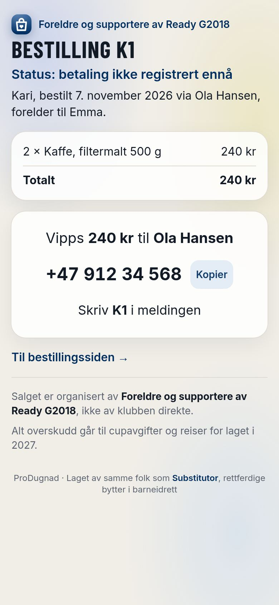</a>

Statussiden

| # | Where | Text |
|---|---|---|
| C1 | Title + status line | Bestilling K7 · Status: betaling ikke registrert ennå / betalt / på vei / levert / avbestilt |
| C2 | Under the title | Kari, bestilt 7. november 2026 via Ola Hansen, forelder til Emma. |
| C3 | Progress steps | Registrert · Betalt · På vei · Levert |
| C4 | List | 2 × *Kaffe, filtermalt 500 g* · Totalt |
| C5 | Link | Til bestillingssiden → |
| C7 | Progress bar | Not shown to friends (only parents and admins: **18 400 kr** til laget av 30 000 kr) |
| C6 | Wrong link | Fant ikke bestillingen. Sjekk at du har hele lenken. |

## D. Shown at the bottom of public pages (transparency)

<a href="screenshots/d-apenhet.jpg">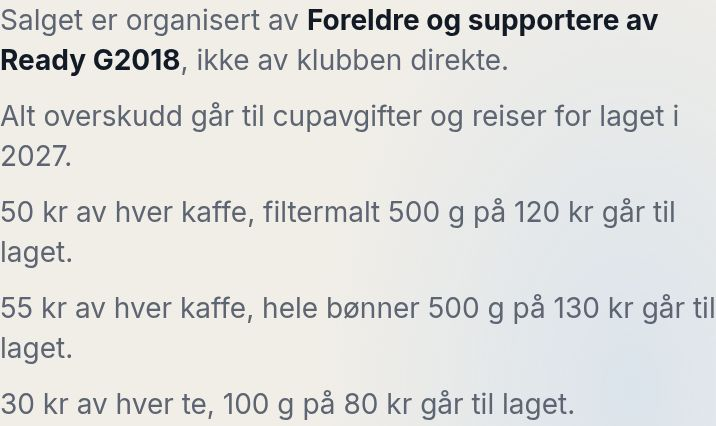</a>

Åpenhet nederst på siden

| # | Where | Text |
|---|---|---|
| D1 | Organizer | Salget er organisert av **Foreldre og supportere av Ready G2018**, ikke av klubben direkte. |
| D2 | Admins (parent page only, not shown to friends) | Ansvarlige: Kari Nordmann (kasserer), +47 912 34 567, Martin P. (koordinator) |
| D3 | Purpose | *Alt overskudd går til …* |
| D4 | Per product | 50 kr av hver kaffe, filtermalt 500 g på 120 kr går til laget. |
| D5 | When finished | *The closing message, see I13* |
| D6 | Footer on every page | ProDugnad · Laget av samme folk som **Substitutor**, rettferdige bytter i barneidrett |

## E. Login and sign-up

<a href="screenshots/e-forside.jpg">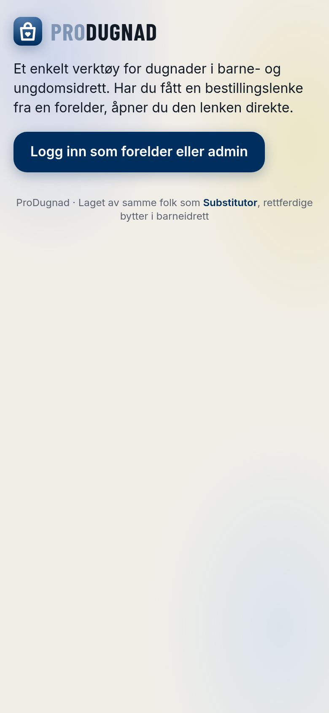</a> <a href="screenshots/e-logg-inn.jpg">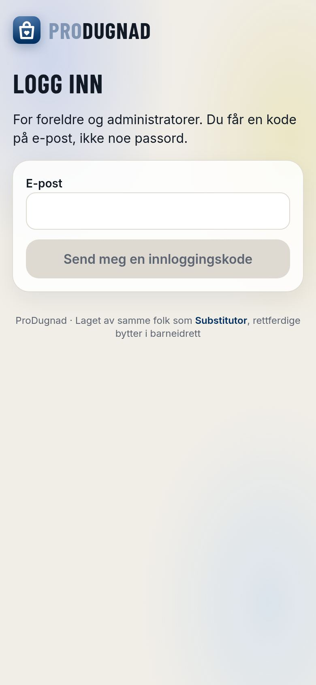</a> <a href="screenshots/e-logg-inn-kode.jpg">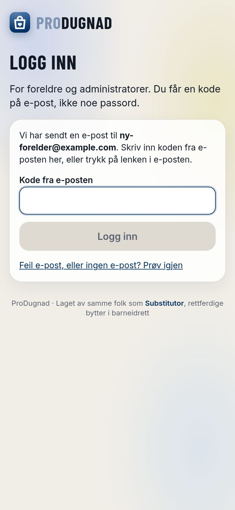</a> <a href="screenshots/e-bli-med-for-innlogging.jpg">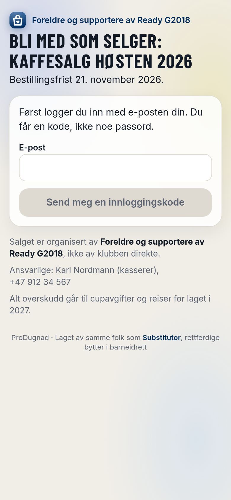</a> <a href="screenshots/e-bli-med-skjema.jpg">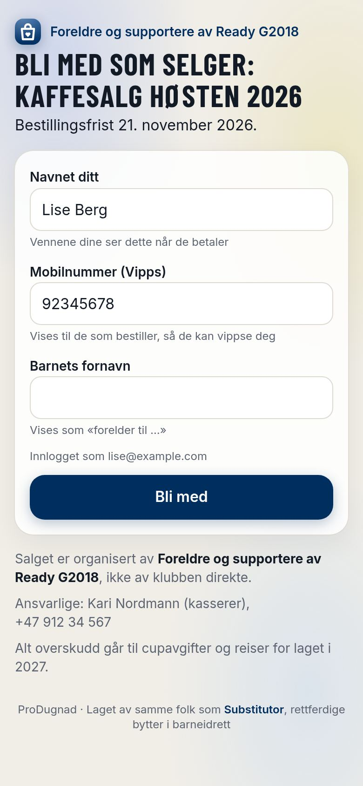</a>

Forside (ikke innlogget) · Logg inn · Etter at koden er sendt · Påmelding før innlogging · Påmelding etter innlogging

| # | Where | Text |
|---|---|---|
| E1 | Front page (logged out) | Et enkelt verktøy for dugnader i barne- og ungdomsidrett. Har du fått en bestillingslenke fra en forelder, åpner du den lenken direkte. |
| E2 | Front page button | Logg inn som forelder eller admin |
| E3 | Login title | Logg inn |
| E4 | Login text | For foreldre og administratorer. Du får en kode på e-post, ikke noe passord. |
| E5 | Field | E-post |
| E6 | Button | Send meg en innloggingskode |
| E7 | After sending | Vi har sendt en e-post til *ola@…*. Skriv inn koden fra e-posten her, eller trykk på lenken i e-posten. |
| E8 | Code field | Kode fra e-posten |
| E9 | Button | Logg inn |
| E10 | Link | Feil e-post, eller ingen e-post? Prøv igjen |
| E11 | Error, wrong code | Koden stemmer ikke, eller den er for gammel. Prøv igjen eller be om en ny. |
| E12 | Error, too soon | Vent litt før du ber om en ny kode. |
| E13 | Error, email failed | Klarte ikke å sende e-posten akkurat nå. Prøv igjen om litt, eller kontakt de ansvarlige. |
| E14 | Sign-up title | Bli med som selger: *Kaffesalg* |
| E15 | Sign-up, deadline | Bestillingsfrist 20. november 2026. |
| E16 | Sign-up, before login | Først logger du inn med e-posten din. Du får en kode, ikke noe passord. |
| E17 | Field + hint | Navnet ditt, slik det står i Vipps · Vennene dine ser dette når de betaler |
| E18 | Field + hint | Mobilnummer (Vipps) · Vises til de som bestiller, så de kan vippse deg |
| E19 | Field + hint | Barnets fornavn · Vises som «forelder til …» |
| E20 | Under the fields | Innlogget som *ola@…* |
| E21 | Button | Bli med |
| E22 | Wrong link | Fant ikke denne påmeldingslenken. |
| E23 | Logged in, no campaign | Du er ikke med i noen dugnad ennå. Be en av de ansvarlige om påmeldingslenken. |
| E24 | Several campaigns | Hei, Ola! · Mine bestillinger (Emma) → |
| E25 | Button | Logg ut |

## F. Parent page (`/forelder/…`)

<a href="screenshots/f-forelderside.jpg">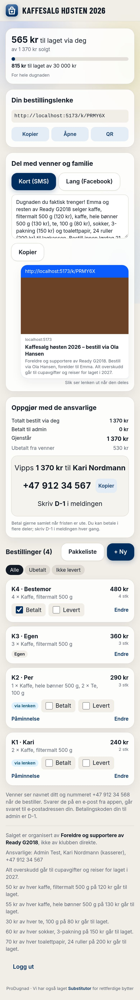</a> <a href="screenshots/f-qr-kode.jpg">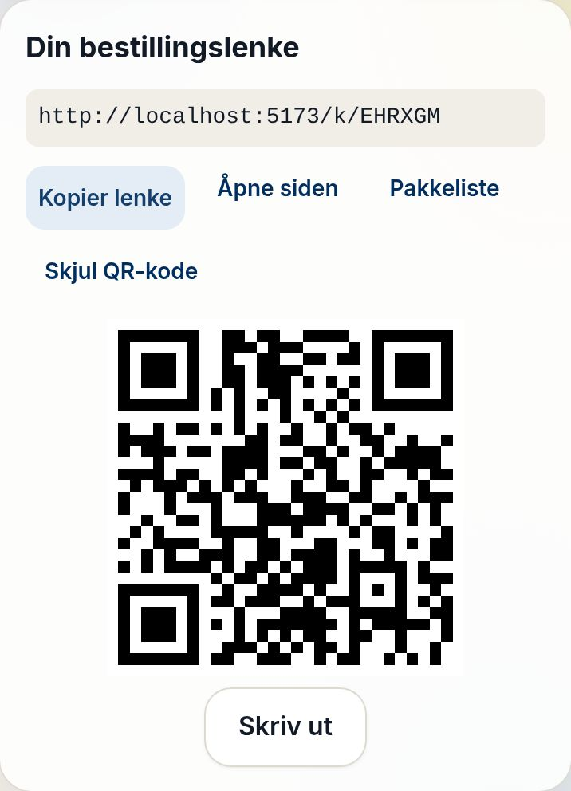</a> <a href="screenshots/f-forelderside-varer-sendt.jpg">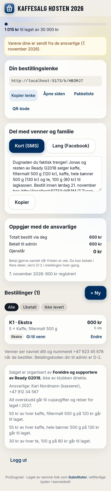</a>

Forelderside · QR-kode · Etter at varene er sendt og betalt

| # | Where | Text |
|---|---|---|
| F1 | Box title | Din bestillingslenke |
| F2 | Buttons | Kopier lenke · Åpne siden · Pakkeliste · QR-kode / Skjul QR-kode |
| F3 | QR print heading | *Kaffesalg* – bestill via *Ola Hansen* · Skriv ut |
| F4 | Box title | Del med venner og familie |
| F5 | Choice | Kort (SMS) · Lang (Facebook) |
| F6 | Buttons | Del · Kopier / Kopiert ✓ |
| F7 | Shown 3 days before deadline | Påminnelse om fristen |
| F8 | Box title | Oppgjør med de ansvarlige |
| F9 | Rows | Totalt bestilt via deg · Betalt til admin · Gjenstår · Ubetalt fra kunder |
| F10 | Vipps box | Vipps **1 440 kr** til **Kari Nordmann**, **+47 912 34 567**, melding **D-1** |
| F11 | Under it | Betal gjerne samlet når fristen er ute. Du kan betale i flere deler; skriv D-1 i meldingen hver gang. |
| F12 | Paid too much | Du har betalt 200 kr for mye. Ta kontakt med de ansvarlige. |
| F13 | Payments list | 7. november 2026: 1 440 kr registrert |
| F14 | List title + button | Bestillinger (4) · + Ny |
| F15 | Filter | Alle · Ubetalt · Ikke levert |
| F16 | Empty list | Ingen bestillinger her ennå. |
| F17 | Order row | K7 · Kari / 2 × *Kaffe…* / 240 kr / 2 stk |
| F18 | Order row tags | Egen · Ekstra · via lenken |
| F19 | Order row actions | Betalt · Levert · Påminnelse · Gi til kunde · Endre |
| F20 | Bottom | Kunder ser navnet ditt og nummeret +47 912 34 568 når de bestiller. Betalingskoden din til admin er D-1. |
| F21 | Locked | Bestillingene er låst. Varene er bestilt fra leverandøren. Du kan fortsatt krysse av betalt og levert. |
| F22 | Finished | Dugnaden er avsluttet. |
| F23 | Goods sent | Varene dine er sendt fra de ansvarlige (7. november 2026). |
| F24 | Error | Fant ikke denne dugnaden for deg. |

## G. Parent: new/edit order, give extra stock, packing list

<a href="screenshots/g-ny-bestilling.jpg">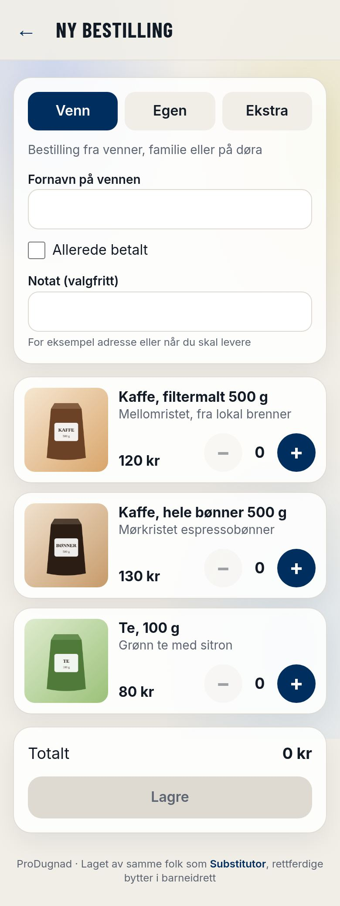</a> <a href="screenshots/g-gi-til-kunde.jpg">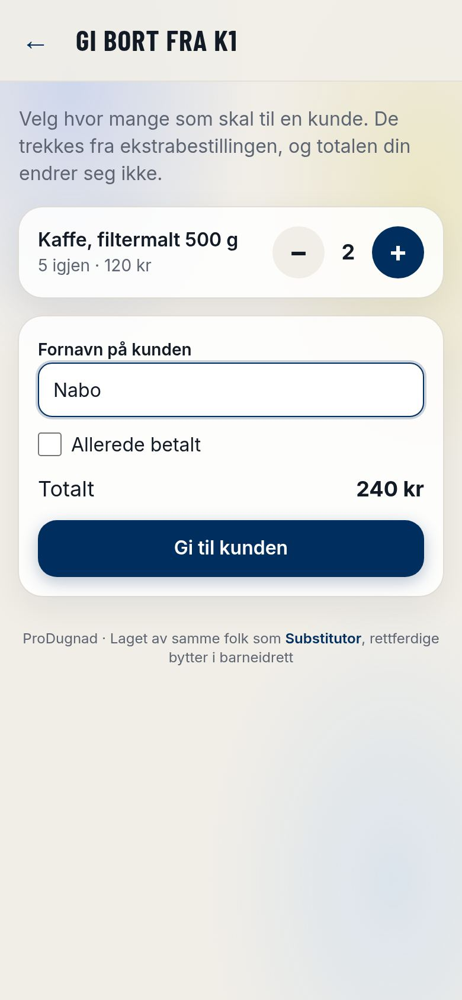</a> <a href="screenshots/g-pakkeliste.jpg">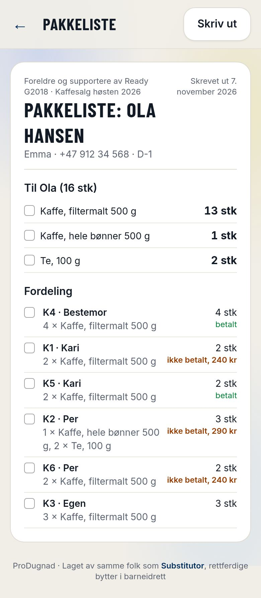</a>

Ny bestilling · Gi ekstra til kunde · Pakkeliste

| # | Where | Text |
|---|---|---|
| G1 | Title | Ny bestilling / Endre K7 |
| G2 | Type buttons + hints | Kunde: Bestilling fra venner, familie eller på døra · Egen: Til din egen husholdning · Ekstra: Lager du selger senere |
| G3 | Field | Fornavn på kunden |
| G4 | Tick box | Allerede betalt |
| G5 | Field + hint | Notat (valgfritt) · For eksempel adresse eller når du skal levere |
| G6 | Buttons | Lagre · Slett bestillingen |
| G7 | Confirm | Slette denne bestillingen? |
| G8 | Locked | Bestillingene er låst. Bare admin kan endre nå. |
| G9 | Give away, title | Gi bort fra K1 |
| G10 | Give away, text | Velg hvor mange som skal til en kunde. De trekkes fra ekstrabestillingen, og totalen din endrer seg ikke. |
| G11 | Give away, row | 5 igjen · 120 kr |
| G12 | Give away, button | Gi til kunden |
| G13 | Give away, error | Skriv inn fornavnet til kunden. |
| G14 | Packing list title | Pakkeliste: Ola Hansen · Emma · +47 912 34 568 · D-1 · Skrevet ut 7. november 2026 |
| G15 | Packing list sections | Til Ola (12 stk) · Fordeling |
| G16 | Packing list status | betalt · ikke betalt, 240 kr |

## H. Admin: start page and Innstillinger

<a href="screenshots/h-administrasjon.jpg">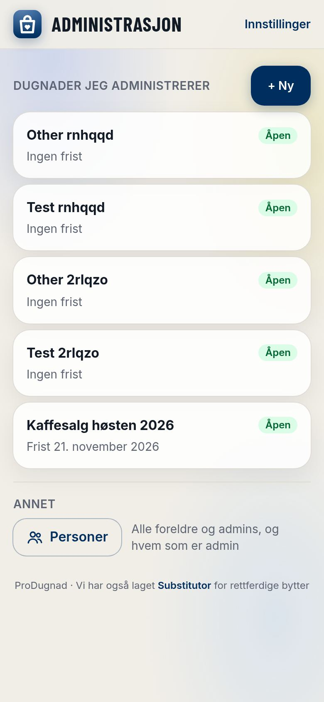</a> <a href="screenshots/h-innstillinger.jpg">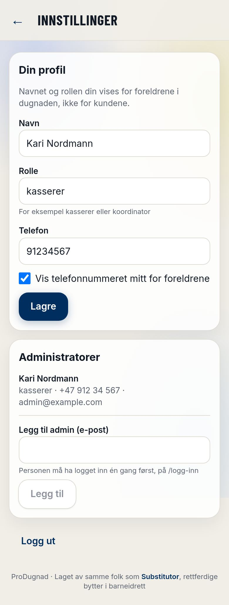</a>

Administrasjon · Innstillinger

| # | Where | Text |
|---|---|---|
| H1 | Title + link | Administrasjon · Innstillinger |
| H2 | Own seller page | Mine bestillinger som selger: *Kaffesalg* → |
| H3 | Button | + Ny dugnad |
| H4 | Campaign card | *Kaffesalg* · Frist 14. november 2026 / Ingen frist · Åpen / Låst / Avsluttet |
| H5 | Empty | Ingen dugnader ennå. |
| H6 | Innstillinger, box title | Din profil |
| H7 | Text | Navnet og rollen din vises for de som får se «Ansvarlige og kontakt» (velges under Oppsett i hver dugnad; vanligvis bare foreldrene). |
| H8 | Fields | Navn · Rolle (For eksempel kasserer eller koordinator) · Telefon |
| H9 | Tick box | Vis telefonnummeret mitt sammen med navnet |
| H10 | Box title | Administratorer |
| H11 | Admin row | *Kari Nordmann* · kasserer · telefon skjult · *e-post* · Fjern |
| H12 | Field + hint | Legg til admin (e-post) · Personen må ha logget inn én gang først, på /logg-inn |
| H13 | Button | Legg til |
| H14 | Admin only | Denne siden er bare for administratorer. |

## I. Admin: a campaign

<a href="screenshots/i-oversikt.jpg">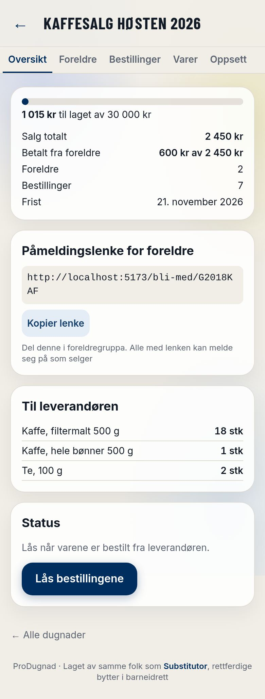</a> <a href="screenshots/i-foreldre.jpg">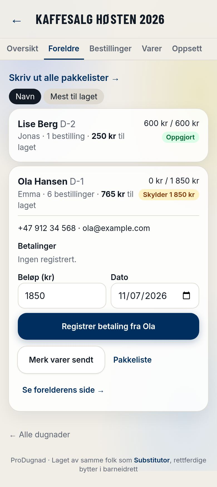</a> <a href="screenshots/i-bestillinger.jpg">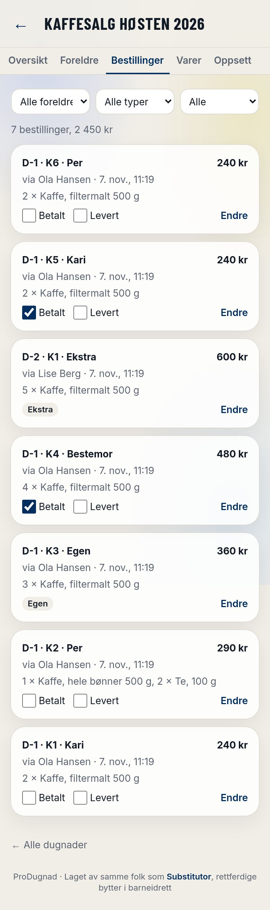</a> <a href="screenshots/i-varer.jpg">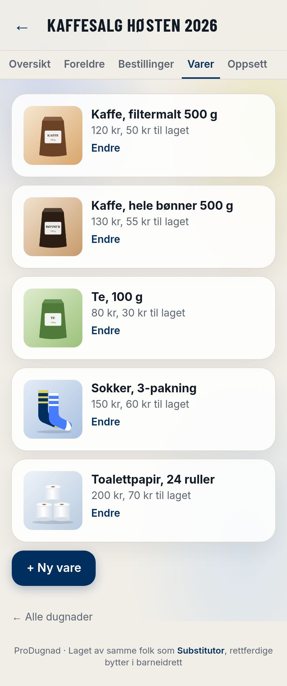</a> <a href="screenshots/i-vare-endre.jpg">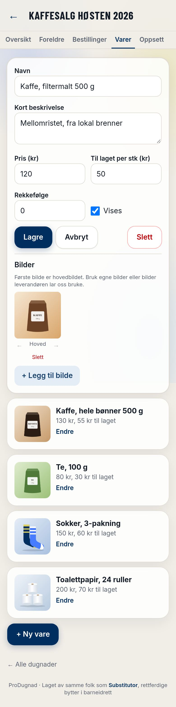</a> <a href="screenshots/i-oppsett.jpg">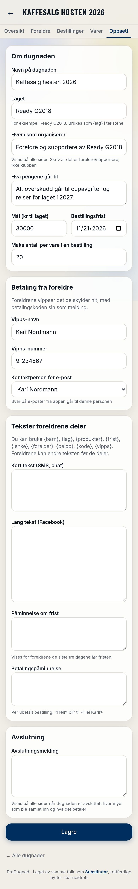</a> <a href="screenshots/i-oppsett-hva-som-vises.jpg">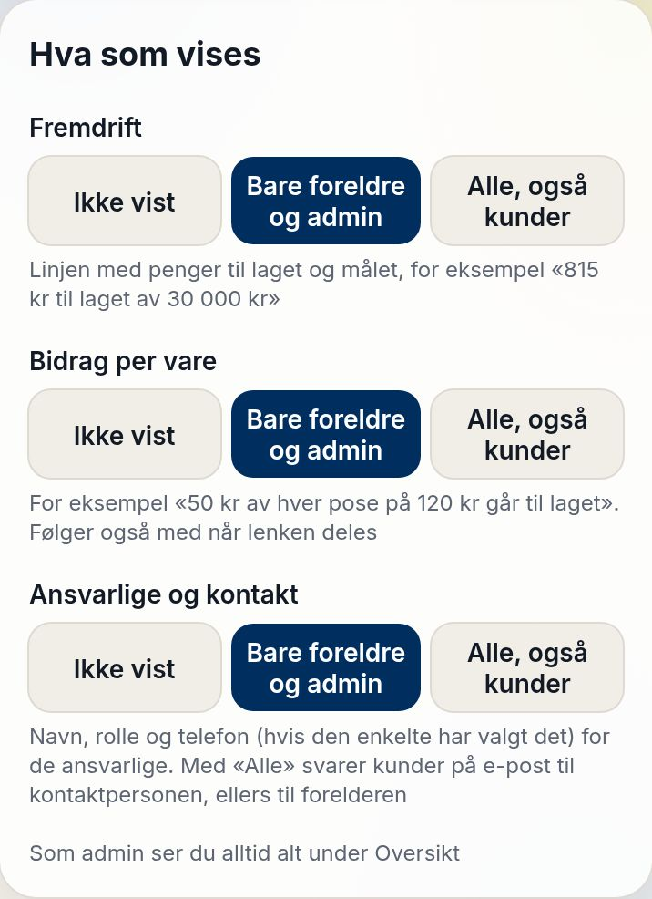</a> <a href="screenshots/i-alle-pakkelister.jpg">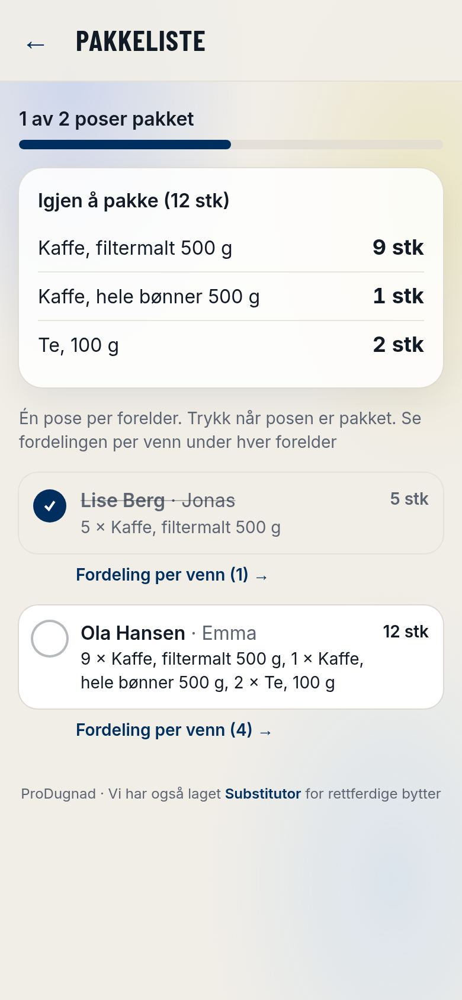</a>

Oversikt · Foreldre (åpnet) · Bestillinger · Varer · Endre vare med bilder · Oppsett · Hva som vises · Alle pakkelister

| # | Where | Text |
|---|---|---|
| I1 | Tabs | Oversikt · Foreldre · Bestillinger · Varer · Oppsett |
| I2 | Oversikt rows | Salg totalt · Betalt fra foreldre (0 kr av 1 970 kr) · Foreldre · Bestillinger · Frist |
| I3 | Sign-up box | Påmeldingslenke for foreldre · Kopier lenke · Del denne i foreldregruppa. Alle med lenken kan melde seg på som selger |
| I4 | Supplier box | Til leverandøren · *14 stk* · Ingen bestillinger ennå. |
| I5 | Status box | Status · Lås når varene er bestilt fra leverandøren. · Lås bestillingene |
| I6 | Status, locked | Låst 7. november 2026. Foreldre kan ikke legge til eller endre bestillinger. · Lås opp · Avslutt dugnaden |
| I7 | Status, finished | Avsluttet 7. november 2026. · Åpne igjen |
| I8 | Confirms | Låse bestillingene? Foreldre og kunder kan ikke bestille eller endre etterpå. · Låse opp bestillingene igjen? · Avslutte dugnaden? Avslutningsmeldingen vises da på alle sider. · Åpne dugnaden igjen? |
| I9 | Foreldre tab | Skriv ut alle pakkelister → · Ola Hansen D-1 · Emma · 4 bestillinger · 0 kr / 1 370 kr · Oppgjort / Skylder 1 370 kr / Betalt 200 kr for mye |
| I10 | Opened parent | Betalinger · Ingen registrert. · Beløp (kr) · Dato · Registrer betaling fra Ola · Slett · Merk varer sendt / Varer sendt 7. november 2026 (angre) · Pakkeliste · Se forelderens side → |
| I11 | Confirms | Slette denne betalingen? · Merke at varene er sendt til Ola Hansen? Forelderen får e-post. |
| I12 | Empty | Ingen foreldre har meldt seg på ennå. Del påmeldingslenken fra Oversikt. |
| I13 | Bestillinger tab | Alle foreldre · Alle typer · Alle / Ubetalt / Betalt / Levert · 5 bestillinger, 1 970 kr · D-1 · K7 · Kari · via Ola Hansen · 7. nov., 10:17 |
| I14 | Varer tab | 120 kr, 50 kr til laget · Skjult · Endre · + Ny vare |
| I15 | Product form | Navn · Kort beskrivelse · Pris (kr) · Til laget per stk (kr) · Rekkefølge · Vises · Lagre · Avbryt · Slett |
| I16 | Pictures | Bilder · Første bilde er hovedbildet. Bruk egne bilder eller bilder leverandøren lar oss bruke. · Hoved · Gjør til hoved · Slett · + Legg til bilde · Laster opp … · Lagre varen først, så kan du legge til bilder. |
| I17 | Product errors | Beløpet til laget kan ikke være høyere enn prisen. · Slette *Kaffe*? Går ikke hvis noen har bestilt den; skjul den i stedet. · Kan ikke slette en vare som er bestilt. Fjern haken for «Vises» i stedet. · Slette bildet? |
| I18 | Oppsett: sections | Om dugnaden · Betaling fra foreldre · Tekster foreldrene deler · Avslutning |
| I19 | Oppsett: fields | Navn på dugnaden · Laget (For eksempel Ready G2018. Brukes som {lag} i tekstene) · Hvem som organiserer (Vises på alle sider. Skriv at det er foreldre/supportere, ikke klubben) · Hva pengene går til · Mål (kr til laget) · Bestillingsfrist · Maks antall per vare i én bestilling |
| I20 | Oppsett: payment | Foreldrene vippser det de skylder hit, med betalingskoden sin som melding. · Vipps-navn · Vipps-nummer · Kontaktperson for e-post (Svar på e-poster fra appen går til denne personen) |
| I21 | Oppsett: texts | Du kan bruke {barn}, {lag}, {produkter}, {frist}, {lenke}, {forelder}, {beløp}, {kode}, {vipps}. Foreldrene kan endre teksten før de deler. · Kort tekst (SMS, chat) · Lang tekst (Facebook) · Påminnelse om frist (Vises for foreldrene de siste tre dagene før fristen) · Betalingspåminnelse (Per ubetalt bestilling. «Hei!» blir til «Hei Kari!») |
| I25 | Oppsett: Hva som vises | Fremdrift (Linjen med penger til laget og målet, for eksempel «815 kr til laget av 30 000 kr») · Bidrag per vare (For eksempel «50 kr av hver pose på 120 kr går til laget». Med «Alle» vises det også når lenken deles) · Ansvarlige og kontakt (Navn, rolle og telefon (hvis den enkelte har valgt det) for de ansvarlige. Med «Alle» svarer kunder på e-post til kontaktpersonen, ellers til forelderen) · Ikke vist / Bare foreldre og admin / Alle, også kunder · Som admin ser du alltid alt under Oversikt |
| I22 | Oppsett: closing | Avslutningsmelding (Vises på alle sider når dugnaden er avsluttet: hvor mye som ble samlet inn og hva det betaler) |
| I23 | Oppsett: button | Opprett dugnaden / Lagre / Lagret ✓ |
| I24 | New campaign: defaults | Kaffesalg · Foreldre og supportere av … · Alt overskudd går til cupavgifter og reiser for laget. |

## J. Default share texts (new campaigns; admins can change them under Oppsett)

<a href="screenshots/j-delingstekst-kort.jpg">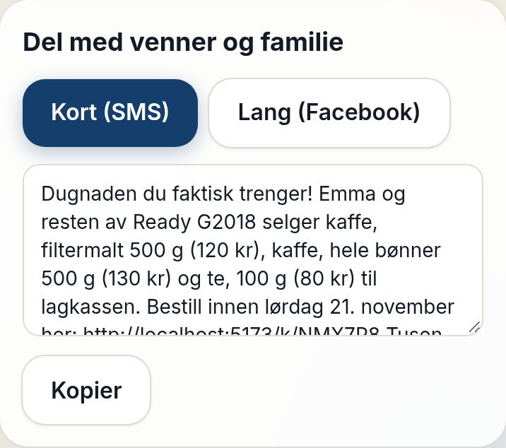</a> <a href="screenshots/j-delingstekst-lang.jpg">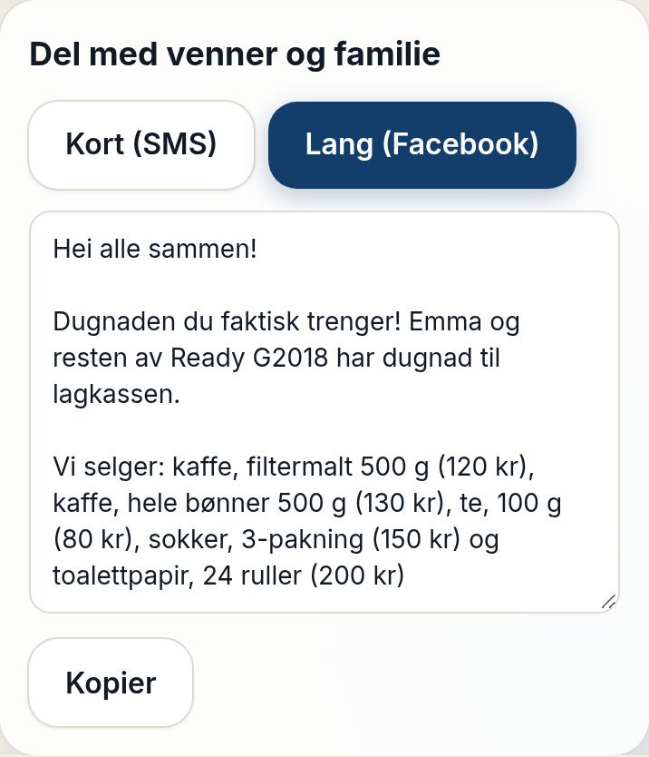</a>

Kort tekst (SMS) · Lang tekst (Facebook)

| # | Where | Text |
|---|---|---|
| J1 | Short (SMS) | Dugnaden du faktisk trenger! {barn} og resten av {lag} selger {produkter} til lagkassen. Bestill innen {frist} her: {lenke} Tusen takk for støtten! |
| J2 | Long (Facebook) | Hei alle sammen! / Dugnaden du faktisk trenger! {barn} og resten av {lag} har dugnad til lagkassen. / Vi selger: {produkter} / Bestill innen {frist} her: {lenke} / Du betaler med Vipps til meg ({forelder}, {vipps}) når du har bestilt, og jeg leverer varene når de kommer. / Tusen takk for at du støtter {barn} og laget! |
| J3 | Deadline reminder | Hei! Bare en påminnelse: fristen for å bestille fra {lag} sin dugnad er {frist}. Bestill her: {lenke} Takk! |
| J4 | Payment reminder | Hei! Bestillingen din {kode} er {beløp}. Vipps til {vipps} med melding {kode}. Takk! |

## K. Emails

<a href="screenshots/k-epost-innlogging.jpg">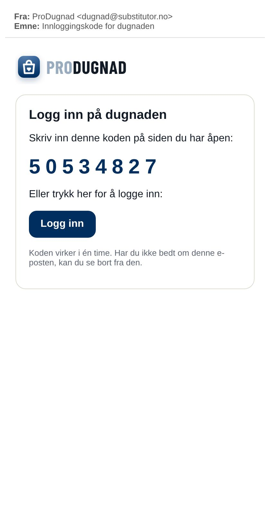</a> <a href="screenshots/k-epost-friend-order.jpg">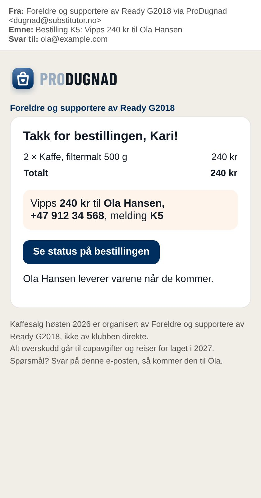</a> <a href="screenshots/k-epost-friend-paid.jpg">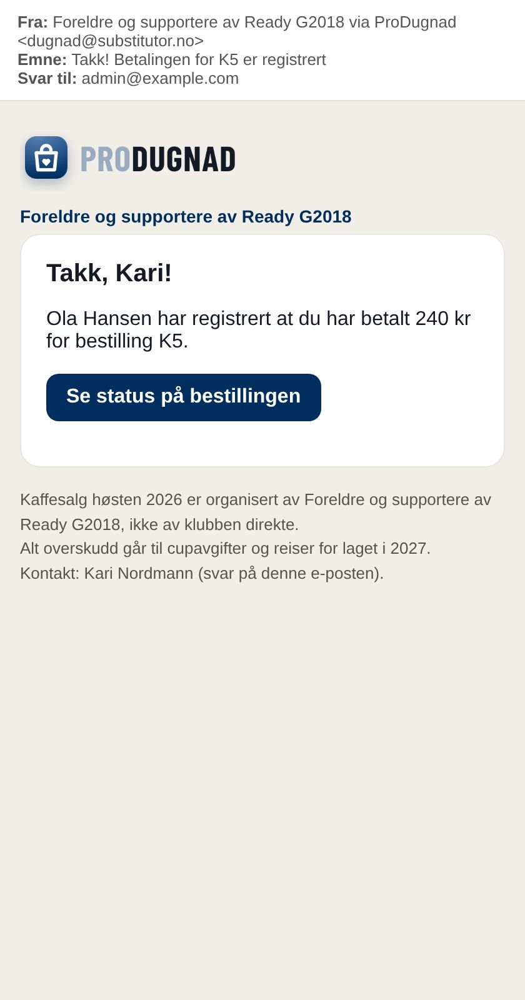</a> <a href="screenshots/k-epost-parent-payment.jpg">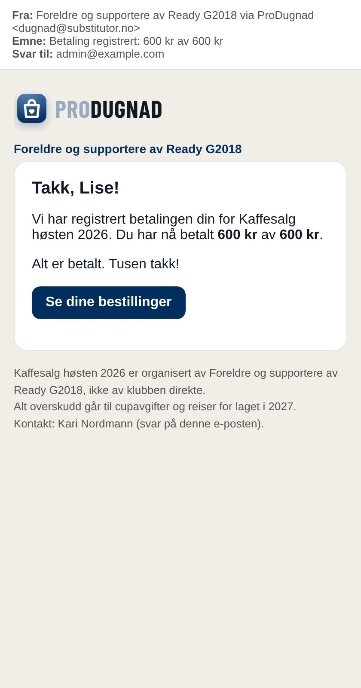</a> <a href="screenshots/k-epost-goods-sent.jpg">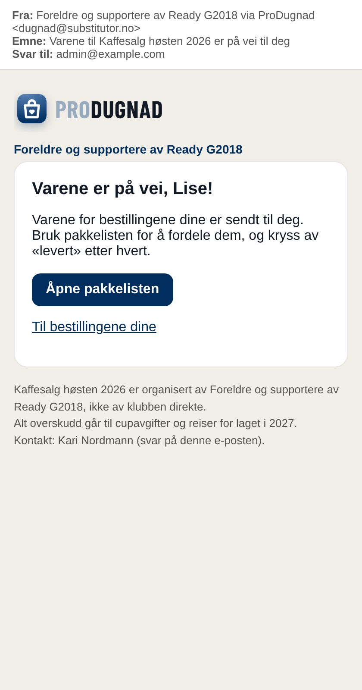</a> <a href="screenshots/k-epost-digest.jpg">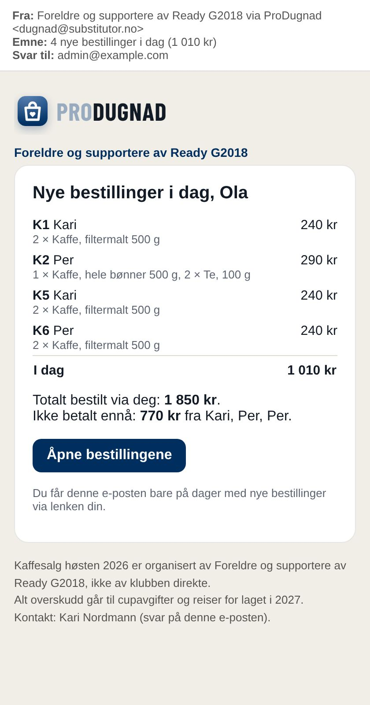</a>

K1 Innlogging · K2 Bestilling · K3 Betalt · K4 Betaling registrert · K5 Varer sendt · K6 Daglig oppsummering

| # | Email | Subject / text |
|---|---|---|
| K1 | Login (Supabase template) | **Innloggingskode for dugnaden** · Logg inn på dugnaden · Skriv inn denne koden på siden du har åpen: · Eller trykk her for å logge inn: · Logg inn · Koden virker i én time. Har du ikke bedt om denne e-posten, kan du se bort fra den. |
| K2 | Friend ordered (opt-in) | **Bestilling K7: Vipps 240 kr til Ola Hansen** · Takk for bestillingen, Kari! · Totalt · Vipps **240 kr** til **Ola Hansen, +47 912 34 568**, melding **K7** · Se status på bestillingen · Ola Hansen leverer varene når de kommer. |
| K3 | Friend paid (opt-in) | **Takk! Betalingen for K7 er registrert** · Takk, Kari! · Ola Hansen har registrert at du har betalt 240 kr for bestilling K7. · Se status på bestillingen |
| K4 | Parent payment registered | **Betaling registrert: 1 440 kr av 1 440 kr** · Takk, Ola! · Vi har registrert betalingen din for *Kaffesalg*. Du har nå betalt **1 440 kr** av **1 440 kr**. · Det gjenstår … / Du har betalt … for mye. Vi tar kontakt. / Alt er betalt. Tusen takk! · Se dine bestillinger |
| K5 | Goods sent | **Varene til *Kaffesalg* er på vei til deg** · Varene er på vei, Ola! · Varene for bestillingene dine er sendt til deg. Bruk pakkelisten for å fordele dem, og kryss av «levert» etter hvert. · Åpne pakkelisten · Til bestillingene dine |
| K6 | Daily digest (20:00) | **3 nye bestillinger i dag (720 kr)** / **1 ny bestilling i dag (240 kr)** · Nye bestillinger i dag, Ola · I dag · Totalt bestilt via deg: … · Ikke betalt ennå: 480 kr fra Kari, Per. / Alle kunder har betalt. · Åpne bestillingene · Du får denne e-posten bare på dager med nye bestillinger via lenken din. |
| K7 | Footer of K2–K6 | *Kaffesalg* er organisert av *Foreldre og supportere av Ready G2018*, ikke av klubben direkte. / *Alt overskudd går til …* / To parents: Kontakt: *Kari Nordmann* (svar på denne e-posten). To friends: Spørsmål? Svar på denne e-posten, så kommer den til Ola. |
| K8 | Sender name | *Foreldre og supportere av Ready G2018* via ProDugnad |

## L. Link previews (Messenger, WhatsApp, SMS)

<a href="screenshots/l-forhandsvisning-bestilling.jpg">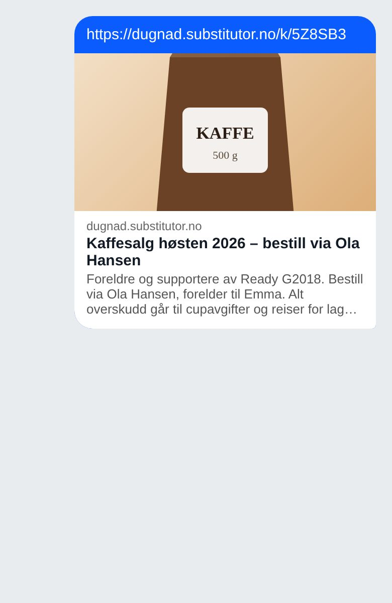</a> <a href="screenshots/l-forhandsvisning-pamelding.jpg">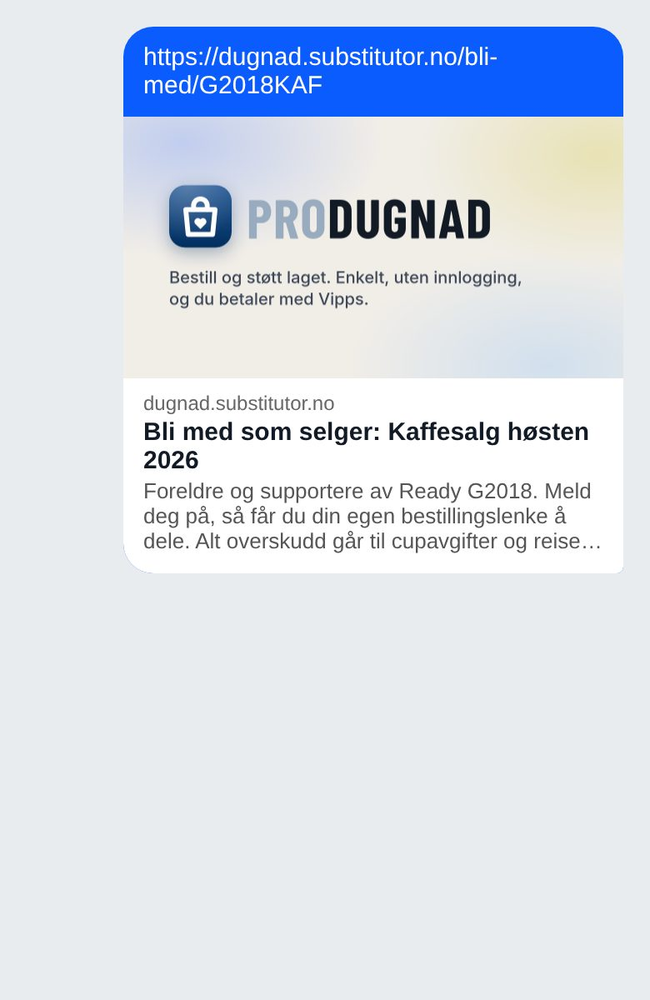</a> <a href="screenshots/l-forhandsvisning-standard.jpg">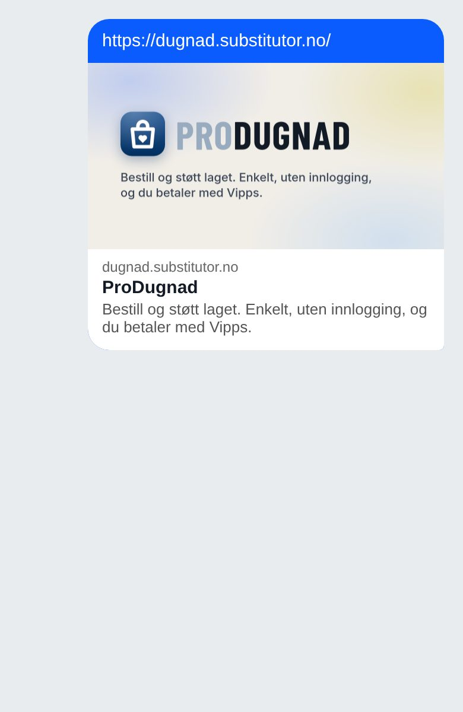</a>

L1 Bestillingslenke · L2 Påmeldingslenke · L3 Alt annet

| # | Link | Title / text |
|---|---|---|
| L1 | Order link | **Kaffesalg – bestill via Ola Hansen** · Foreldre og supportere av Ready G2018. Bestill via Ola Hansen, forelder til Emma. *Alt overskudd …* 50 kr av hver kaffe, filtermalt 500 g går til laget. |
| L2 | Sign-up link | **Bli med som selger: Kaffesalg** · Foreldre og supportere av Ready G2018. Meld deg på, så får du din egen bestillingslenke å dele. *Alt overskudd …* |
| L3 | Everything else | **ProDugnad** · Bestill og støtt laget. Enkelt, uten innlogging, og du betaler med Vipps. |
| L4 | Default picture | PRODUGNAD · Bestill og støtt laget. Enkelt, uten innlogging, og du betaler med Vipps. |

## M. Error messages

<a href="screenshots/m-feil-uten-navn.jpg">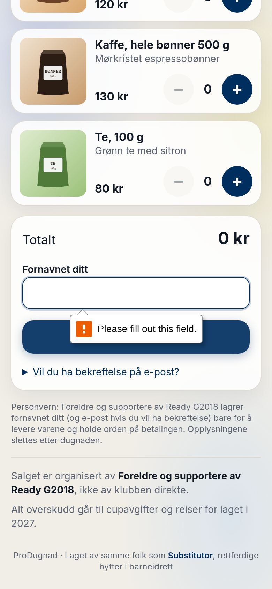</a> <a href="screenshots/m-feil-lenke.jpg">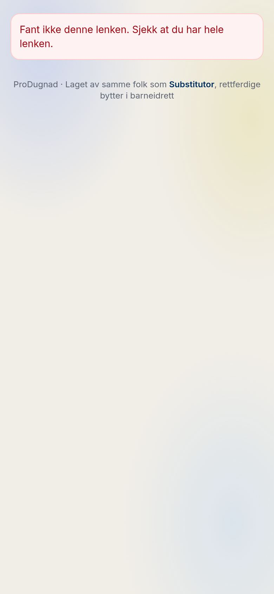</a> <a href="screenshots/m-side-finnes-ikke.jpg">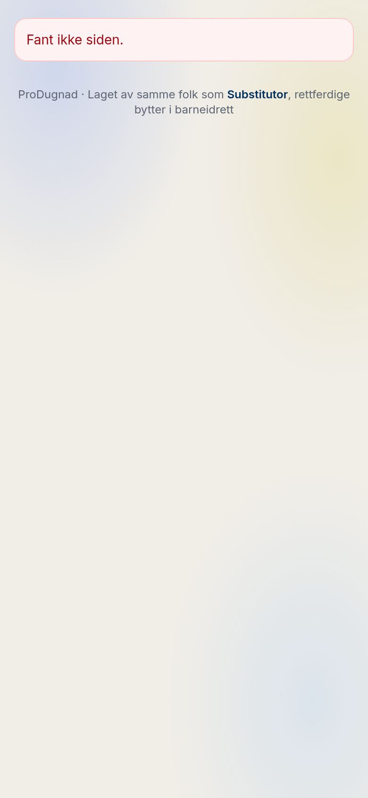</a>

Bestill uten navn · Feil lenke · Side finnes ikke

| # | When | Text |
|---|---|---|
| M1 | Ordering after close | Dugnaden tar ikke imot flere bestillinger. |
| M2 | Changing after lock | Bestillingene er låst fordi varene er bestilt fra leverandøren. |
| M3 | Missing name | Skriv inn et fornavn. |
| M4 | Bad email | E-postadressen ser ikke riktig ut. |
| M5 | Too many | Antallet er for høyt. |
| M6 | Product removed | En av varene finnes ikke lenger. Last siden på nytt. |
| M7 | Other product problem | Noe gikk galt med varene. Last siden på nytt. |
| M8 | Too many orders at once | Mange bestillinger akkurat nå. Prøv igjen om litt. |
| M9 | Sign-up form | Fyll inn navn og telefonnummer. |
| M10 | Not logged in | Du må logge inn først. |
| M11 | No access | Du har ikke tilgang til dette. |
| M12 | Add admin, unknown | Fant ingen bruker med den e-postadressen. Personen må logge inn én gang først. |
| M13 | Remove last admin | Det må være minst én admin. |
| M14 | Extra stock | Dette er ikke en ekstrabestilling. · Du har ikke så mange igjen av ekstrabestillingen. |
| M15 | No connection | Fikk ikke kontakt med serveren. Sjekk nettet og prøv igjen. |
| M16 | Anything else | Noe gikk galt. Prøv igjen. |
| M17 | Crash | Noe gikk galt · Siden kunne ikke vises. Prøv å laste inn på nytt. Hjelper ikke det, ta kontakt med de ansvarlige. · Last inn på nytt |
| M18 | After an update | Ny versjon · Appen er oppdatert. Last inn siden på nytt for å fortsette. |
| M19 | Unknown page | Fant ikke siden. |
